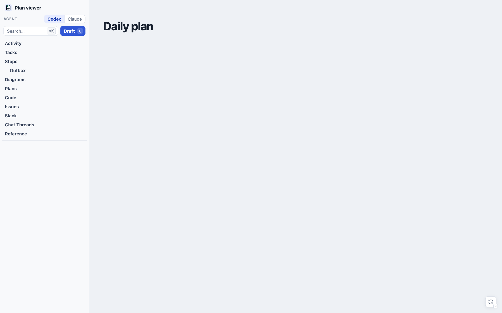
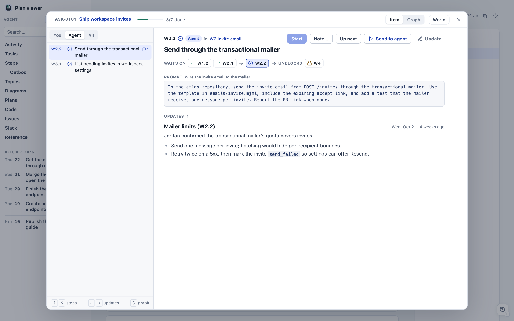
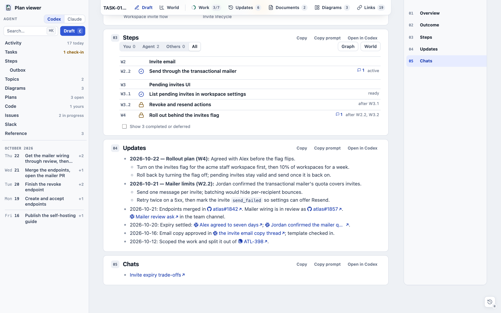
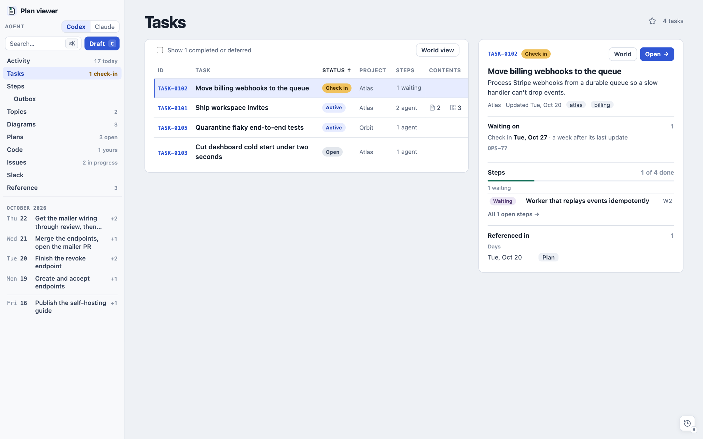
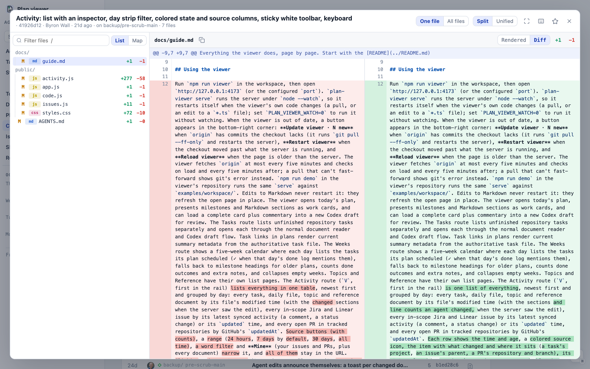
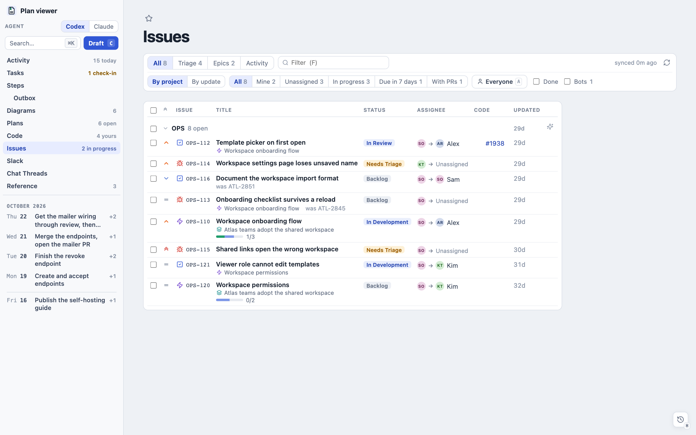
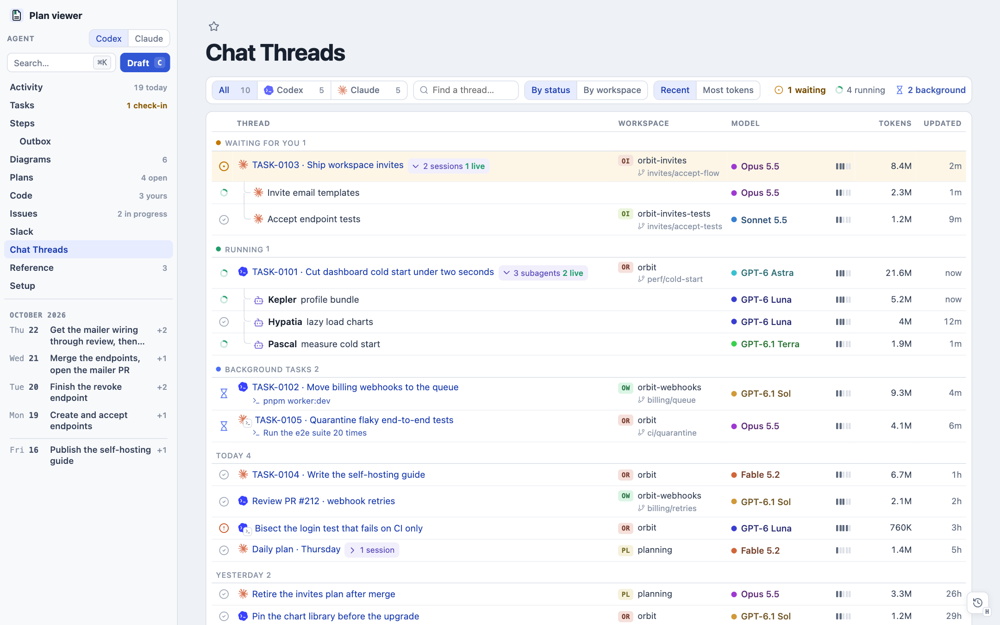
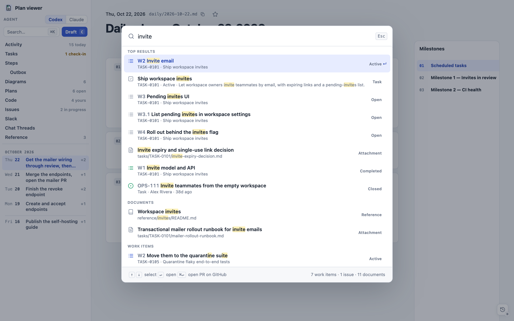

# Plan Viewer

**A local reading desk for planning in Markdown and handing the work to coding agents.**

You keep daily plans, tasks, and notes as plain Markdown files in a folder or Git repository. Plan Viewer turns that folder into a fast, keyboard-driven app: today's plan as work cards, tasks as lists of steps with dependency graphs, and one-click handoffs that load any piece of work into a [Codex](https://openai.com/codex/) or [Claude](https://claude.com/download) desktop draft, and a live list of every agent thread that work starts. Beside your plans sit the pull requests, worktrees, diffs, and issues that the work touches.

The viewer never edits your files. Your Markdown stays the source of truth, readable anywhere, and agents make the changes.



## Set it up with your agent

You need [Node.js](https://nodejs.org) 22.6 or later and an agent such as [Claude Code](https://claude.com/claude-code) or [Codex](https://openai.com/codex/). There is nothing to install.

```bash
git clone https://github.com/byronwall/plan-viewer.git
cd plan-viewer
```

Then start your agent in `plan-viewer` and tell it:

```text
Read docs/setup.md and set me up.
```

The agent creates your workspace in `../planning`, starts the viewer, asks you four questions, and writes today's plan and your first task. To do it yourself instead, see [Set it up by hand](#set-it-up-by-hand).

## What you get

**Plans that read as work.** The viewer opens today's plan. Each milestone or section is a card, and scheduled tasks show how many of their steps wait on you, an agent or someone else. Tasks, PRs, commits, and Linear or Jira keys become links that show live titles and states.

**Hand any piece of work to an agent.** Every card, step and agent button saves its prompt, with the source context and a note you add, to an Up next queue that an orchestrating agent thread works through. Opening it as a draft in Codex or Claude Desktop is one click further, and nothing runs until you send it.



**Tasks with real structure.** A task file can carry a work breakdown with prerequisites. The viewer lists its steps by who moves next, with a dependency graph one click away, and marks what is ready and what waits on prerequisites. `plan-viewer lint` keeps every task valid.



**Every task in one list.** Tasks lists everything unfinished, with an inspector for the selected one. Progress lives on the task itself: its status and dated updates.



**The code your plans touch.** The Code view watches the repositories you track: worktrees, open PRs with CI and review state, commits across branches, cleanup of stale worktrees, and a full diff viewer with split and unified views, viewed marks, local review notes, and a treemap of each change.



**Issues beside the plan.** The Issues page syncs Jira (through `acli`) and Linear into a dense list with triage, epics, and an activity feed, joined to the PRs that mention each issue.



**Every agent thread in one place.** Chat Threads lists your local Codex and Claude Code threads: what waits for you, what runs, and what waits on a background command. Subagents and side sessions sit under the thread that started them, each with its model, reasoning effort and token use. Click a title to open the conversation in its desktop app.



**Everything from the keyboard.** `⌘K` searches documents, tasks, PRs, and issues. Single letters move between pages (`T` today, `A` tasks, `G` code, `I` issues), and `?` lists every shortcut.



## Set it up by hand

A workspace is a folder of Markdown plans beside your `plan-viewer` checkout. To start one:

```bash
git clone https://github.com/byronwall/plan-viewer.git
mkdir planning && cd planning
../plan-viewer/cli.ts init
```

`init` sets up what the viewer and your agents need:

- a git repository, with its hooks path set to the checkout's `hooks/`, so each commit lints staged plans and checks links;
- a `.gitignore` for `tmp/` (the viewer's caches) and `config.toml` (Linear and Slack tokens);
- the `config/`, `daily/`, `tasks/` and `reference/` folders;
- `AGENTS.md` and `CLAUDE.md` from the example workspace, with the real path to `cli.ts` in their commands.

Nothing is installed: the workspace runs the checkout's `cli.ts` directly. `init` never replaces an existing file or setting, so you can run it again in a partly set up workspace. It prints what it did and what it skipped.

Then run `../plan-viewer/cli.ts` in the workspace to start the viewer.

Write today's plan at `daily/YYYY-MM-DD.md` and it opens on launch. The copied `AGENTS.md` (which `CLAUDE.md` imports) tells your agents how plans and tasks are written. [`examples/workspace/`](examples/workspace) is a full sample workspace: a small fictional team's week.

### Workspace layout

```text
daily/YYYY-MM-DD.md            # the day's plan; "## Scheduled tasks" links tasks
tasks/TASK-0001/TASK-0001.md   # one task: front matter, outcome, work breakdown, next actions, updates
tasks/TASK-0001/               # the task's documents, diagrams, images and notes/ sit beside it
reference/                     # prose people and agents read; notes/ holds notes tied to no task
config/viewer.json             # optional preferences
config/                        # other files the tooling reads: code-repos.json, slack-channels.md, prompts/
config.toml                    # optional, git-ignored secrets: [linear] API_KEY, [slack] TOKEN
```

A task file looks like this:

````markdown
---
id: TASK-0101
title: Ship workspace invites
summary: Let owners invite teammates by email.
status: active
project: Atlas
tags: [atlas]
created: 2026-10-12
updated: 2026-10-21
---

# Ship workspace invites

## Work breakdown

- W1: Invite API [completed]
- W2: Invite email [active] (after: W1)

## Next actions

### Wire the invite email to the mailer

Work item: W2

```prompt
Send the invite email from POST /invites through the mailer and add a test.
```
````

### Commands

Run each from the workspace (or set `PLANNING_ROOT`). `plan-viewer help` lists them. A mistake, such as a missing file or a busy port, prints one line and exits 1.

| Command | Does |
| --- | --- |
| `plan-viewer serve` | Starts the viewer at `http://127.0.0.1:4173`, restarting itself when the viewer's code changes. |
| `plan-viewer init` | Sets up the folder as a workspace: git and its hooks path, `.gitignore`, folders, and the agent guide. Nothing to install. Never replaces a file. |
| `plan-viewer lint [paths…\|--staged]` | Checks task front matter, work breakdowns, and action references. |
| `plan-viewer links [--fix\|--warm\|--refresh-slack]` | Reports broken links, unknown tasks, unlinked task assets, and unnamed Slack channels. |
| `plan-viewer move <from> <to\|TASK-NNNN>` | Moves one file and repairs every link to it. `TASK-NNNN` moves it into that task's folder; the task must exist. |
| `plan-viewer migrate [--write]` | Moves a workspace from the older layout (`tasks/TASK-NNNN.md` with `-assets/`, `daily/YYYY/MM/DD/`, `plans/`, `viewer.config.json`) to this one. Without `--write` it lists the moves and what to fix first. |
| `plan-viewer task TASK-NNNN` | Prints a task's context in compact form for an agent. |
| `plan-viewer next [--json]` | Prints the steps flagged Up next, for an agent thread to work through. |

### Optional integrations

Each one is off until you set it up, and credentials stay with their own tools:

| For | You need |
| --- | --- |
| Agent handoffs | macOS with Codex Desktop or Claude Desktop. Pick one under **Agent** in the sidebar. |
| PR and commit links, the Code view | [`gh`](https://cli.github.com), signed in, and `github` in `config/viewer.json`. |
| Jira titles and the Issues page | [`acli`](https://developer.atlassian.com/cloud/acli/), signed in, and `issues.jql`. |
| Linear titles and issues | `LINEAR_API_KEY`, or `[linear] API_KEY` in `config.toml`. |
| Slack link titles | `SLACK_TOKEN`, or `[slack] TOKEN` in `config.toml`. |

The editor, terminal, and Finder buttons also assume macOS. Reading plans works anywhere Node runs.

## Documentation

- [User guide](docs/guide.md): every page, shortcut, and behavior in detail.
- [Configuration](docs/configuration.md): `config/viewer.json` and environment variables.
- [Code view design](docs/code-view.md), [Issues plan](docs/issues-plan.md), and [Plans plan](docs/plans-plan.md): why those surfaces work the way they do.

## Contributing

The server is TypeScript that Node runs directly (`--experimental-strip-types`), and the browser client is plain ES modules in [`public/`](public). There is no build step and no runtime dependency.

```bash
npm test          # runs every test against fixtures/planning
npm run dev:demo  # serves examples/workspace, a fictional sample workspace, on port 4173
```

`npm install` enables a pre-commit hook that runs the tests. [`AGENTS.md`](AGENTS.md) maps features to files and lists the rules for changes; it is written for coding agents but is the fastest orientation for anyone. To refresh the screenshots above, see [`scripts/screenshots.mjs`](scripts/screenshots.mjs).
