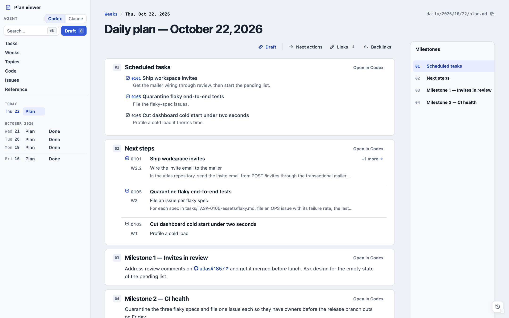
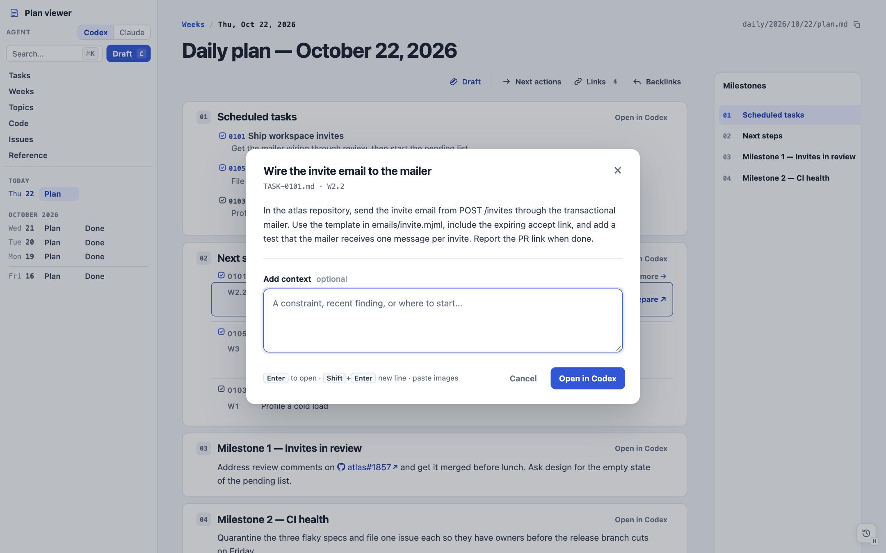
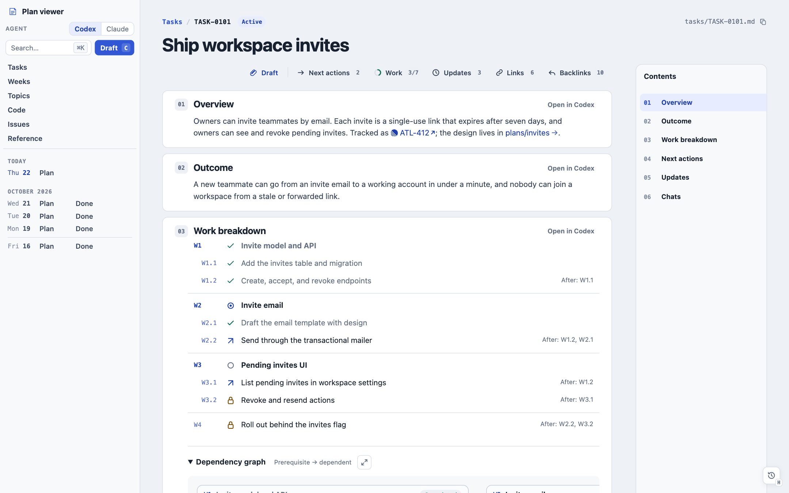
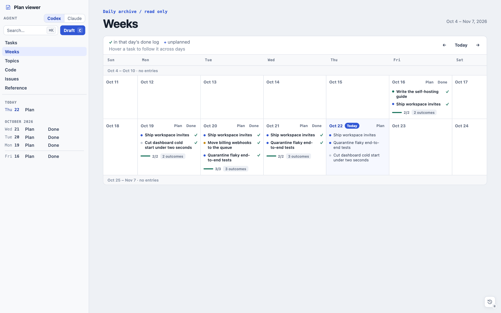
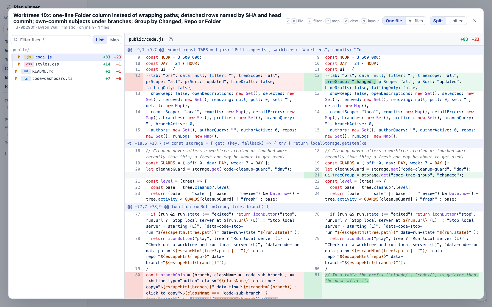
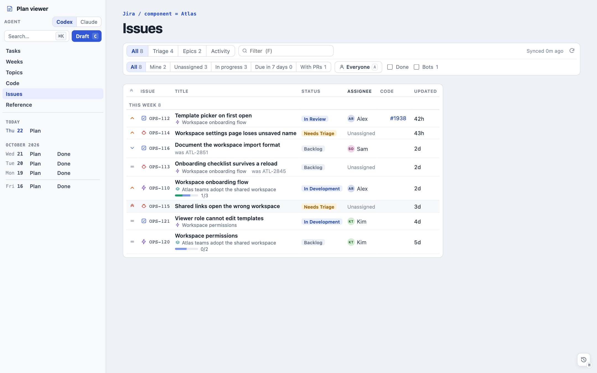
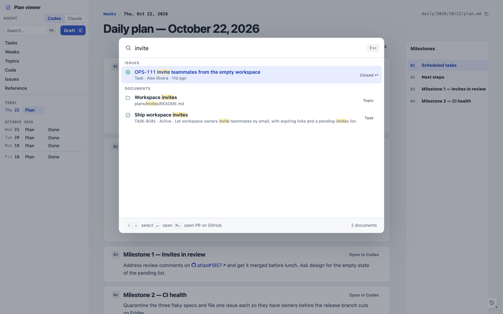

# Plan Viewer

**A local reading desk for planning in Markdown and handing the work to coding agents.**

You keep daily plans, tasks, and notes as plain Markdown files in a folder or Git repository. Plan Viewer turns that folder into a fast, keyboard-driven app: today's plan as work cards, tasks with dependency graphs, a calendar of what got done, and one-click handoffs that load any piece of work into a [Codex](https://openai.com/codex/) or [Claude](https://claude.com/download) desktop draft. Beside your plans sit the pull requests, worktrees, diffs, and issues that the work touches.

The viewer never edits your files. Your Markdown stays the source of truth, readable anywhere, and agents make the changes.



## What you get

**Plans that read as work.** The viewer opens today's plan. Each milestone or section is a card, and scheduled tasks bring their next action with them. Tasks, PRs, commits, and Linear or Jira keys become links that show live titles and states.

**Hand any piece of work to an agent.** Every card and next action opens as an editable draft in Codex or Claude Desktop, with the source context attached. You add a note, review the prompt, and send it yourself. Nothing runs until you do.



**Tasks with real structure.** A task file can carry a work breakdown with prerequisites. The viewer draws it as a tree and a dependency graph, marks what is ready, and blocks actions whose prerequisites aren't done. `plan-viewer lint` keeps every task valid.



**See the week at a glance.** Weeks lays out each day's scheduled tasks and checks off the ones its done log mentions. Tasks lists everything unfinished, with an inspector for the selected one.



**The code your plans touch.** The Code view watches the repositories you track: worktrees, open PRs with CI and review state, commits across branches, cleanup of stale worktrees, and a full diff viewer with split and unified views, viewed marks, local review notes, and a treemap of each change.



**Issues beside the plan.** The Issues page syncs Jira (through `acli`) and Linear into a dense list with triage, epics, and an activity feed, joined to the PRs that mention each issue.



**Everything from the keyboard.** `⌘K` searches documents, tasks, PRs, and issues. Single letters move between pages (`T` today, `A` tasks, `W` weeks, `G` code, `I` issues), and `?` lists every shortcut.



## Try it

You need [Node.js](https://nodejs.org) 22.6 or later. There are no dependencies to install.

```bash
git clone https://github.com/byronwall/plan-viewer.git
cd plan-viewer
npm install
npm run demo
```

Open <http://127.0.0.1:4173>. The demo serves [`examples/workspace/`](examples/workspace), a small fictional team's week: five tasks, daily plans and done logs, a topic, and a stand-in Jira so the Issues page has data. The Code view is empty until you track a repository (gear icon on the Code page).

## Use it with your own plans

A workspace is any folder laid out like the example. To start one beside your `plan-viewer` checkout:

```bash
mkdir planning && cd planning && git init
mkdir -p daily tasks plans reference
cp ../plan-viewer/examples/workspace/{AGENTS,CLAUDE}.md .
```

Add a `package.json` that points at the viewer:

```json
{
  "private": true,
  "type": "module",
  "devDependencies": { "plan-viewer": "file:../plan-viewer" },
  "scripts": {
    "viewer": "plan-viewer serve",
    "lint": "plan-viewer lint",
    "links": "plan-viewer links",
    "move": "plan-viewer move",
    "task": "plan-viewer task",
    "prepare": "git config core.hooksPath node_modules/plan-viewer/hooks"
  }
}
```

Then run `npm install` and `npm run viewer`. Install with `npm`, not `pnpm`: pnpm copies `file:` packages into `node_modules`, where Node refuses to run TypeScript directly. The `prepare` script installs a pre-commit hook that lints staged plans and checks links.

Write today's plan at `daily/YYYY/MM/DD/plan.md` and it opens on launch. The copied `AGENTS.md` (which `CLAUDE.md` imports) tells your agents how plans and tasks are written, so you can also just ask one to set the workspace up.

### Workspace layout

```text
daily/YYYY/MM/DD/plan.md     # the day's plan; "## Scheduled tasks" links tasks
daily/YYYY/MM/DD/done.md     # what got done
daily/YYYY/MM/DD/*.md|.txt   # optional day notes
tasks/TASK-0001.md           # one task: front matter, outcome, work breakdown, next actions, updates
tasks/TASK-0001-assets/      # documents and images owned by that task
plans/<topic>/               # cross-day topics (plans/README.md indexes them)
reference/                   # stable reference documents
viewer.config.json           # optional preferences
config.toml                  # optional, git-ignored secrets: [linear] API_KEY, [slack] TOKEN
```

A task file looks like this:

````markdown
---
id: TASK-0101
title: Ship workspace invites
summary: Let owners invite teammates by email.
status: active
project: Atlas
tags: [atlas]
created: 2026-10-12
updated: 2026-10-21
---

# Ship workspace invites

## Work breakdown

- W1: Invite API [completed]
- W2: Invite email [active] (after: W1)

## Next actions

### Wire the invite email to the mailer

Work item: W2

```prompt
Send the invite email from POST /invites through the mailer and add a test.
```
````

### Commands

Run each from the workspace (or set `PLANNING_ROOT`):

| Command | Does |
| --- | --- |
| `plan-viewer serve` | Starts the viewer at `http://127.0.0.1:4173`, restarting itself when the viewer's code changes. |
| `plan-viewer lint [paths…\|--staged]` | Checks task front matter, work breakdowns, and action references. |
| `plan-viewer links [--fix\|--warm\|--refresh-slack]` | Reports broken links, unknown tasks, unlinked task assets, and unnamed Slack channels. |
| `plan-viewer move <from> <to\|TASK-NNNN>` | Moves a file and repairs every link to it. |
| `plan-viewer task TASK-NNNN` | Prints a task's context in compact form for an agent. |

### Optional integrations

Each one is off until you set it up, and credentials stay with their own tools:

| For | You need |
| --- | --- |
| Agent handoffs | macOS with Codex Desktop or Claude Desktop. Pick one under **Agent** in the sidebar. |
| PR and commit links, the Code view | [`gh`](https://cli.github.com), signed in, and `github` in `viewer.config.json`. |
| Jira titles and the Issues page | [`acli`](https://developer.atlassian.com/cloud/acli/), signed in, and `issues.jql`. |
| Linear titles and issues | `LINEAR_API_KEY`, or `[linear] API_KEY` in `config.toml`. |
| Slack link titles | `SLACK_TOKEN`, or `[slack] TOKEN` in `config.toml`. |

The editor, terminal, and Finder buttons also assume macOS. Reading plans works anywhere Node runs.

## Documentation

- [User guide](docs/guide.md): every page, shortcut, and behavior in detail.
- [Configuration](docs/configuration.md): `viewer.config.json` and environment variables.
- [Code view design](docs/code-view.md), [Issues plan](docs/issues-plan.md), and [Plans tab plan](docs/plans-plan.md): why those surfaces work the way they do.

## Contributing

The server is TypeScript that Node runs directly (`--experimental-strip-types`), and the browser client is plain ES modules in [`public/`](public). There is no build step and no runtime dependency.

```bash
npm test        # runs every test against fixtures/planning
npm run demo    # serves examples/workspace
```

`npm install` enables a pre-commit hook that runs the tests. [`AGENTS.md`](AGENTS.md) maps features to files and lists the rules for changes; it is written for coding agents but is the fastest orientation for anyone. To refresh the screenshots above, see [`scripts/screenshots.mjs`](scripts/screenshots.mjs).
